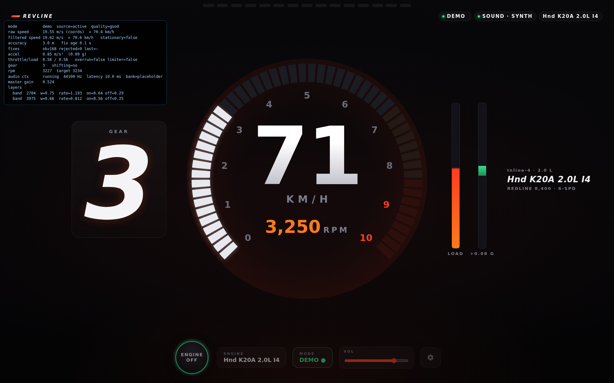

# REVLINE — virtual engine sound for EVs



A static web app for the Tesla in-car browser. It estimates speed and acceleration from the browser's
GPS, runs a simulated combustion drivetrain (throttle, gears, RPM, shifts, overrun) and plays an engine
soundtrack through Web Audio, with a racing-style HUD. Demo Mode runs the same pipeline without GPS.

- React 19 + TypeScript (strict) + Vite 7, Web Audio API, Geolocation API. No backend, no runtime dependencies besides React.
- Location is processed only in the browser tab. Nothing is stored or sent.

## Quick start

```bash
npm install
npm run dev          # http://localhost:5173
```

1. Press **START ENGINE**.
2. **ENGINE** → pick one of the 20 engines from qb-changesound.
3. **MODE** → pick a scenario (Full cycle, City, Acceleration, Highway, Hard acceleration, Deceleration).
4. Watch speed, RPM and automatic shifts, and listen. Add `?debug=1` to the URL for the diagnostics overlay.

Other scripts:

```bash
npm run typecheck    # tsc --noEmit (strict)
npm test             # node --test: motion, drivetrain, mixing, profiles, import tooling
npm run build        # typecheck + production build to dist/
npm run preview      # serve dist/
npm run audio:import -- --repo ../qb-changesound --engine k20a   # convert real engine audio
```

## Engine audio: current status

The original sounds are GTA V `.awc` containers, which browsers cannot decode. This repo includes a
conversion tool (`tools/audio-import`, see [docs/AUDIO_PIPELINE.md](docs/AUDIO_PIPELINE.md)) that
turns them into small Opus loops. **No bank has been converted yet**, so every engine currently plays a
built-in procedural placeholder (marked `SYNTH PREVIEW` / `SOUND · SYNTH` in the UI). Once a bank is
converted and committed, that engine uses the real recording automatically.
Inventory of the source repository: [docs/AUDIO_INVENTORY.md](docs/AUDIO_INVENTORY.md).

## Deploy to GitHub Pages

1. Push this project to a GitHub repository (branch `main`).
2. Repository **Settings → Pages → Build and deployment → Source: GitHub Actions**.
3. Every push to `main` runs `.github/workflows/deploy.yml`: install → typecheck → test → build with
   `BASE_PATH=/<repo-name>/` → deploy. The site appears at `https://<user>.github.io/<repo-name>/`.

For a custom domain or a `<user>.github.io` repository, set `BASE_PATH: /` in the workflow.
For a local production build with a sub-path: `BASE_PATH=/my-repo/ npm run build`.

## In the car

1. Open the HTTPS Pages URL in the Tesla browser (location only works over HTTPS).
2. Set the engine and volume while parked, press **START ENGINE**, allow location.
3. The HUD shows GPS status and accuracy. If permission is denied, GPS stops updating or accuracy is poor,
   a message says so and the engine holds its last state instead of jumping.

Browser-only constraints: a website cannot read Tesla CAN bus, pedal position or real speed, so throttle
and RPM are **estimated** from GPS speed changes (≈1 Hz updates; small lag is expected). The browser may
pause audio when the tab is hidden; a "TAP TO RESUME" button appears.

## Project layout

```
src/
  motion/       GPS + demo sources, MotionEstimator (filtering)
  drivetrain/   gearbox, throttle estimation, VirtualDrivetrain
  profiles/     engines/*.json (auto-loaded), schema validation
  audio/        EngineAudioEngine, SoundBankLoader, mixing math, placeholder synth (TODO)
  core/         EngineSession (pipeline + tick loop), store, settings
  components/ pages/ hooks/ styles/   HUD
tests/          unit tests (node --test)
tools/audio-import/   AWC → Opus conversion
docs/           ARCHITECTURE, AUDIO_INVENTORY, AUDIO_PIPELINE
```

See [docs/ARCHITECTURE.md](docs/ARCHITECTURE.md) for the data flow and the filtering/drivetrain details.

## Safety

Configure before driving. Keep the volume at a level where you can hear sirens and traffic.
